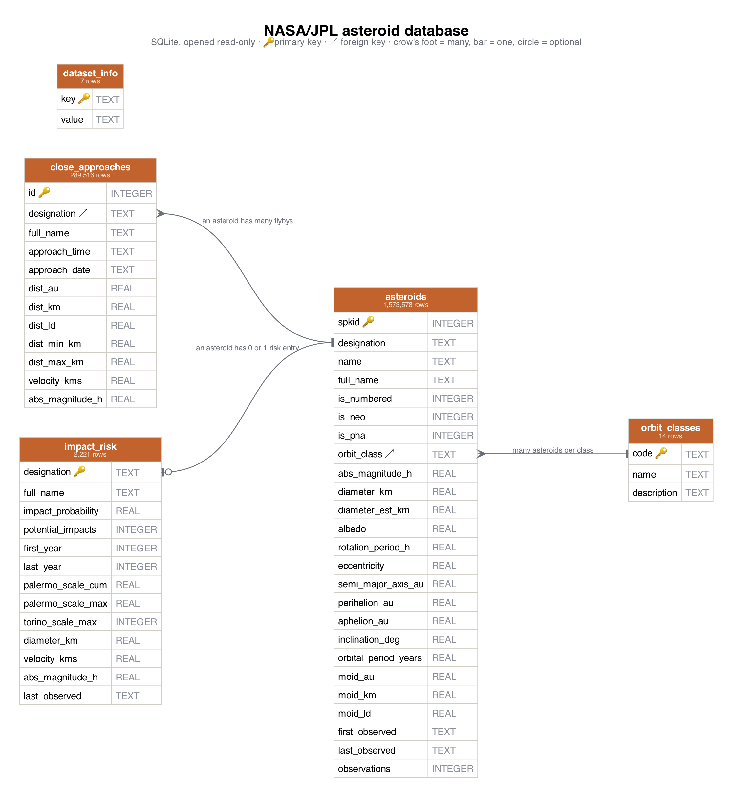

# Asteroid Q&A: ask NASA's asteroid database in plain English

My database holds **every asteroid NASA/JPL tracks**: 1,573,578 of them, including 42,732 near-Earth asteroids and 2,550 potentially hazardous ones. It also holds 289,516 Earth close approaches from 1900 to 2200 and NASA's 2,221-object Sentry impact-risk list. You type a question, an LLM writes the SQL, the app runs it **read-only**, and the LLM turns the rows back into a plain-English answer.



### Class submission checklist (CS 452 AI + SQL project)

| Required item | Where |
|---|---|
| Working code files | this repo (see [Files](#files)) |
| The SQLite database | `asteroids.db.gz` on the [Releases page](https://github.com/searlejk/asteroid-nl-sql/releases/latest) (520 MB unzipped, too big to commit), or rebuild it with `python3 build_db.py` |
| Description of the database | the paragraph above |
| Picture of the schema | [schema.png](schema.png) |
| A question, SQL and response that worked | [SAMPLES.md](SAMPLES.md#a-question-it-did-well-on) |
| A question, SQL and response that didn't work | [SAMPLES.md](SAMPLES.md#a-question-it-tripped-up-on) |
| A file with at least 6 other examples | [EXAMPLES.md](EXAMPLES.md) (every question × every strategy is in [responses/ALL_RESULTS.md](responses/ALL_RESULTS.md)) |
| Prompting strategies tried and the differences | [Prompting strategies](#prompting-strategies) |

Data comes from three public NASA/JPL Solar System Dynamics APIs: [SBDB Query](https://ssd-api.jpl.nasa.gov/doc/sbdb_query.html) (orbits and sizes), [Close Approach Data](https://ssd-api.jpl.nasa.gov/doc/cad.html) (flybys) and [Sentry](https://ssd-api.jpl.nasa.gov/doc/sentry.html) (impact risk).

## How it works

```
question ──► LLM (schema + strategy examples) ──► SQL ──► read-only SQLite ──► rows (+ which tables were read)
                │                                  ▲            │ error?
                │                                  └─ one repair attempt (error + "column X lives in table Y")
                └─ "UNANSWERABLE" ──► one "double-check" prompt ──► still unanswerable? ──► fixed refusal
rows read no table, or all NULL? ──► fixed refusal / "no data" (the LLM never sees it)
rows + question + SQL ──► LLM (answer rules + domain facts) ──► grounding check ──► answer
                                                                     └─ fails? ──► raw result shown instead
```

**Read-only by construction.** The model can never change the data, because of five independent layers ([db.py](db.py)):
1. The file is opened with SQLite `mode=ro`.
2. `PRAGMA query_only = ON`.
3. An authorizer callback allows only SELECT/READ/FUNCTION actions, so INSERT, UPDATE, DELETE, DROP, CREATE, ATTACH and PRAGMA are denied, including when hidden inside a `WITH`.
4. Only a single `SELECT`/`WITH` statement is accepted.
5. The `.db` file is `chmod 444`.

Queries are also stopped after 15 s and capped at 1,000 rows. [tests/test_readonly.py](tests/test_readonly.py) tries 13 attack queries. All are blocked, and the database file's sha256 is unchanged afterwards.

**Answers come only from the data.** A small model will happily fill gaps from its own "knowledge". Asked what weekday it was, it answered "Wednesday" after the query returned NULL (it was a Tuesday). Prompt rules alone didn't stop this, so [nlq.py](nlq.py) and [grounding.py](grounding.py) enforce it in code:
1. **The query must read a data table.** The SQLite authorizer records every table a query reads. `SELECT strftime('%A', 'now')` reads none, so it's refused with fixed text.
2. **Questions the data can't answer are refused.** If the model answers with `SELECT 'UNANSWERABLE' …` (for mass, composition, discoverers, today's date and so on), it gets one "double-check" prompt. If it repeats the refusal, the user sees a fixed message. The model's own free-text reason is never shown, because it tended to contain invented facts.
3. **Empty or all-NULL results never reach the LLM.**
4. **Grounding check.** Every number in the written answer must match a value in the results or the question (within 2% or the rounding shown). Conversions the prompt allows are accepted only where the wording calls for them: km ↔ lunar distances ↔ au; fraction ↔ percent only when written with "%"; probability → N only when written as "1 in N". A full date such as "April 13, 2044" must equal a date in the results, not a day from one row and a year from another. Weekday names must appear in the results. [tests/test_grounding.py](tests/test_grounding.py) holds real bad answers from the 3B model that must be caught, and good answers that must pass. If anything fails, the model's wording is discarded and the raw result is shown. The UI shows the rejected text under the SQL panel.
5. **The answer step sees only the question, the SQL and the rows**, plus fixed answer-writing rules. It doesn't get today's date or dataset notes, because those were exactly what it used to embellish answers.

**Better friendly answers.** The class example sends GPT only the question and the raw tuples. This app also sends the SQL, the column names and the row count, plus rules: the Sentry list means "can't be ruled out yet", not "will hit"; give probabilities as "1 in N"; for long lists, give the total first.

## Run it

```bash
pip install -r requirements.txt
# get the database: download asteroids.db.gz from the Releases page and unzip it into data/ ...
mkdir -p data && gunzip -c ~/Downloads/asteroids.db.gz > data/asteroids.db
# ... or rebuild it from NASA/JPL (~7 min, ~520 MB; add --neo-only for near-Earth only, ~30 s)
python3 build_db.py
cp config.example.json config.json   # then paste your OpenAI key into config.json
python3 server.py            # http://localhost:8452
```

The `provider` setting in `config.json`:
- `auto` (default): OpenAI if a key is present, otherwise a local model.
- `openai`: always OpenAI.
- `local`: Qwen2.5-Coder-3B running on-device via llama.cpp. No key or cost, but weaker.

Download the local model once with:

```bash
python3 -c "from huggingface_hub import hf_hub_download as d; d('Qwen/Qwen2.5-Coder-3B-Instruct-GGUF','qwen2.5-coder-3b-instruct-q4_k_m.gguf',local_dir='models')"
```

Other entry points:
- `python3 nlq.py "How many asteroids are there?"`: ask from the terminal.
- `python3 run_experiments.py`: runs [questions.json](questions.json) through all 3 strategies and writes `responses/response_<strategy>_<time>.json` and `responses/summary_<time>.md`.
- `python3 make_examples_md.py`: turns the latest run into [responses/ALL_RESULTS.md](responses/ALL_RESULTS.md) (every question × every strategy).

## Prompting strategies

These come from [Chang & Fosler-Lussier 2023](https://arxiv.org/abs/2305.11853). Every strategy gets the schema as `CREATE TABLE` statements with column comments, plus 3 example rows per table. That's the paper's best-performing schema representation. They differ only in the demonstrations ([nlq.py](nlq.py)):

| Strategy | Demonstrations |
|---|---|
| zero_shot | none |
| single_domain | 8 question → SQL pairs written for *this* database |
| cross_domain | question → SQL pairs from *other* databases (the class dog-show schema and a flights schema), each shown with its own schema |

Scoring uses **execution accuracy**, as in the paper. Each of 14 questions has a hand-written gold query, and a generated query counts as correct if it returns the same answer. Two open-ended questions are judged by hand. The repair step is turned off for these runs so the strategies are compared fairly.

### Results: local Qwen2.5-Coder-3B (4-bit, on an M4 MacBook)

| Run | zero_shot | single_domain | cross_domain |
|---|---|---|---|
| v1 prompts | 8/14 | 9/14 | 8/14 |
| v2 prompts (column-location and date rules, stricter answer rules) | 10/14 | 11/14 | 9/14 |
| v3 + "only from the data" guards (unanswerable path, table-read check, grounding check) | **8/14** | **11/14** | **10/14** |

v3 adds four hand-graded questions. Two of them can't be answered from the data: elephants (no masses) and today's weekday. All three strategies now refuse both, where v2 invented "332,033,780,600 kg" and "Wednesday". The cost is over-refusal: "Is any asteroid going to hit Earth?" and "Will we have a problem with any of the biggest near-Earth asteroids?" are also refused, although the impact-risk table could answer them. The grounding check rejected one answer, the zero-shot Apophis answer that stitched a date together from two rows. Zero-shot dropped from 10 to 8 because of SQL dialect slips (`INTERVAL '10 years'`, `YEAR()`) after the prompt changed, not because of the guards.

The full latest table is in [responses/](responses/). Every question with each strategy's SQL and answer is in [responses/ALL_RESULTS.md](responses/ALL_RESULTS.md). The two sample questions (one that worked, one that didn't) are in [SAMPLES.md](SAMPLES.md), and six more annotated examples are in [EXAMPLES.md](EXAMPLES.md). Earlier runs are archived in [responses/v1_local/](responses/v1_local/) and [responses/v2_local/](responses/v2_local/).

**What I noticed**
- **Single-domain examples helped most.** They taught the model the date idioms (`date('now')`) and the join from a name to its close approaches.
- **Copy bias.** With single-domain examples, the model copied the example that was *closest* to the question instead of reading it. Asked "How many near-Earth asteroids are there?", it reused the hazardous-asteroids example (`WHERE is_pha = 1`).
- **Cross-domain examples were the weakest** for this small model. It borrowed the `T1`/`T2` aliasing style from them and then referenced columns on the wrong alias.
- **The friendly answer is the riskier half.** Even with correct SQL, a 3B model sometimes ignores answer rules and invents details.

### Results: OpenAI GPT-4o

*Pending: add your key to `config.json`, run `python3 run_experiments.py`, and paste `responses/summary_<time>.md` here.*

## A question it did well on

**Question:** When will Apophis pass Earth, and how close will it get? *(single_domain)*

```sql
SELECT ca.full_name, ca.approach_time, ca.dist_km, ca.dist_ld, ca.velocity_kms
FROM close_approaches ca JOIN asteroids a ON a.designation = ca.designation
WHERE a.name = 'Apophis' AND ca.approach_date >= date('now')
ORDER BY ca.approach_time LIMIT 1;
```
**Raw result:** `('99942 Apophis (2004 MN4)', '2029-04-13 21:46', 38011.46, 0.0989, 7.42)`

**Friendly response:** Apophis will pass Earth on April 13, 2029. It will be about 38,011 km (0.09889 lunar distances) away. The asteroid's velocity is 7.423 km/s.

That matches NASA's published figure: closer than geostationary satellites.

## Questions it tripped up on

**Question:** Is any asteroid going to hit Earth? *(zero_shot)*

```sql
SELECT designation FROM impact_risk WHERE impact_probability > 0
```
The SQL is reasonable: it returns the 2,221 objects on the Sentry list.

**Friendly response:** *"Yes, there are asteroids going to hit Earth. The query found 1000+ asteroids with an impact probability greater than 0…"*

That's wrong and alarming. Being on the list means an impact can't be ruled out *yet*, and the highest probability is about 1 in 10. Like the dog-show example in the class sample post, the data was right but the interpretation was not. Adding domain facts to the answer prompt improved this with the 3B model, but didn't fully fix it.

**Question:** How many asteroids have orbits that come within 0.05 au of Earth's orbit? *(all strategies)*

```sql
SELECT COUNT(DISTINCT designation) FROM close_approaches WHERE moid_au <= 0.05;
```
`no such column: moid_au`. The model put the orbit-distance column on the flyby table. In the web app, the repair step sends the error back with the hint "column moid_au exists only in table(s): asteroids". The 3B model still returned the same query.

**Question:** Which upcoming year will have the most asteroid flybys closer than the Moon? *(single_domain)*

It grouped by `approach_date` (day) instead of year. It then answered "2189" from a single-flyby day, a confident answer to a different question.

**Question:** What day of the week is it today? *(before the grounding guards)*

```sql
SELECT strftime('%A', date('now')) AS day_of_week;
```
**Raw result:** `[(None,)]`. SQLite has no `%A`, and the query doesn't read any table.

**Friendly response:** *"Today is Wednesday."* That's invented, and wrong too: it was a Tuesday. Now the query is refused because it reads no data table. The model also usually picks `UNANSWERABLE` for questions like this, and the user gets a fixed "this database doesn't contain that" message.

**Question:** How many elephants does the heaviest asteroid weigh? *(before the guards)*

```sql
SELECT SUM(diameter_est_km * 1000) AS total_weight FROM asteroids WHERE diameter_est_km IS NOT NULL;
```
The database has no masses, so the model invented a stand-in: it added up the diameters of all 1.5 million asteroids, in metres, and called that a weight. The answer then said "332,033,780,600 kg", which is 100× the query result, and got stuck repeating ",000" until it hit the length limit. Now the question is refused, a repetition penalty plus a trimmer stop the runaway output, and the grounding check would reject the 100× number.

**Question:** When will Apophis pass Earth, and how close will it get? *(zero_shot)*

The SQL returned all 28 Apophis flybys. The answer stitched "April 13" from 2029 onto "2044" from another row: *"April 13, 2044, at a distance of about 8.03 AU"*. The whole-date check now catches this.

**Over-refusal (the trade-off).** Once refusing was allowed, the 3B model started refusing some questions the data *can* answer. "Is any asteroid going to hit Earth?" was refused even after the double-check prompt. A refusal is safer than an invented answer, but it's still a miss.

**Data quirk:** "What is the largest asteroid?" returns **Eris**. JPL's small-body catalogue includes dwarf planets (Eris, Pluto, Makemake, Ceres), so the SQL was correct for this data.

## Files

| File | What |
|---|---|
| [build_db.py](build_db.py) | downloads NASA/JPL data and builds `data/asteroids.db` |
| [schema.sql](schema.sql) | commented schema, used both to build the DB and in every prompt |
| [db.py](db.py) | read-only query execution |
| [llm.py](llm.py) | OpenAI / local llama.cpp providers |
| [nlq.py](nlq.py) | prompts, strategies, SQL extraction, repair, out-of-scope handling, friendly answer |
| [grounding.py](grounding.py) | checks that every number and weekday in an answer comes from the results |
| [server.py](server.py), [web/](web/) | web app (Python standard library, no framework) |
| [run_experiments.py](run_experiments.py), [questions.json](questions.json) | strategy comparison with execution accuracy |
| [make_schema_png.py](make_schema_png.py) | draws `schema.png` with Graphviz |
| [tests/test_readonly.py](tests/test_readonly.py) | proves the DB can't be modified |

`config.json` (your API key), `models/` and `data/*.db` are git-ignored. The full database is 520 MB, too big for GitHub, so rebuild it with `build_db.py`. `--neo-only` makes a small one.
